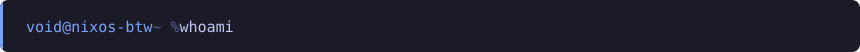
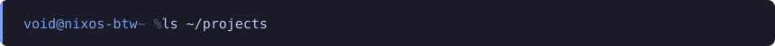
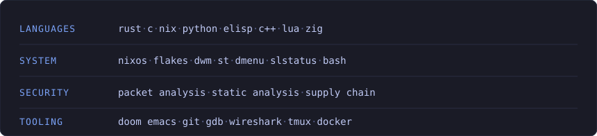

  

Systems and security engineer. I work close to the metal and I like knowing
exactly what a machine is doing — which packets cross it, which binaries ship
inside it, and which lines of config put them there.

Most of what I build is **defensive**: tools that watch traffic, inspect
artifacts, and surface the things that should not be there. The rest is the
machine I build them on — a **NixOS** system where the entire desktop, down to
the patched `dwm` binary, is declared in a flake and reproducible from scratch.

- Writing **Rust** for anything that has to be correct under load
- Writing **C** for anything that has to be small — and patching suckless tools
- Running **NixOS + dwm + st + dmenu**, the whole host declared in `nix`
- Living in **Doom Emacs**, driving everything else from `bash` and `tmux`
- Reverse-engineering how things work before trusting them

| | project | lang | what it does |
|---|---|---|---|
| `drwxr-xr-x` | **[Stomper](https://github.com/void-kusho/Stomper)** | Rust | Network intrusion detection system. Captures live traffic, detects suspicious network behaviour, raises alerts and renders them on a local dashboard. |
| `drwxr-xr-x` | **[bsuppla](https://github.com/void-kusho/bsuppla)** | Rust | Statically analyses Docker images **without executing them**, flagging suspicious binaries that indicate supply-chain compromise. |
| `drwxr-xr-x` | **[suckless-environment](https://github.com/void-kusho/suckless-environment)** | Nix / C | My whole machine as a flake — NixOS host, patched `dwm`/`st`/`dmenu`/`slstatus`, Doom Emacs, dunst and tmux. One `nixos-rebuild` reproduces the desktop from bare metal. |

  
  

  

